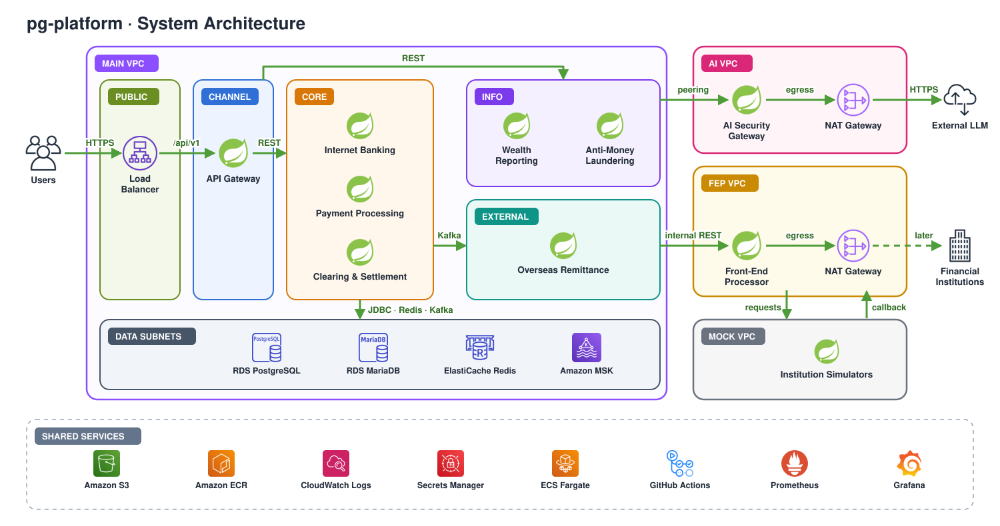

# pg-platform

<p align="center">
  
</p>

pg-platform is a payment and banking platform laid out the way a Korean bank splits its systems. A channel layer faces customers, a core layer owns accounts and the ledger, an external layer handles overseas messages, and an information layer runs reports and anti-money-laundering checks. Every request to an outside institution leaves through one front-end processor (FEP), and every request to an outside AI model leaves through a separate AI gateway.

The repository is a Gradle monorepo of 16 Spring Boot services and 5 shared libraries, plus Terraform for a four-VPC AWS network. Its design goal is that money stays correct when something fails. It is a skeleton today: the structure, wiring, architecture rules and infrastructure code are in place, and the business logic is still TODO.

## Works with

---

| System | What pg-platform does with it | Today |
| --- | --- | --- |
| Payment gateway (PG) | Approves, cancels and refunds card payments through FEP | `mock-pg` |
| SWIFT | Sends pacs.008 messages built from MT103 input and receives pacs.002 status | `mock-swift` |
| KoFIU (Korea Financial Intelligence Unit) | Receives anti-money-laundering reports through FEP | `mock-kofiu` |
| Clearing house | Exchanges daily settlement files through FEP | `mock-clearing` |
| External LLM provider | Drafts wealth-report text from pseudonymized data, through ai-gateway | Not connected. The host allow-list is empty. |
| AWS (ap-northeast-2) | VPCs, ECS Fargate, ALB, RDS, ElastiCache, MSK, S3, ECR, Secrets Manager | Terraform only. Nothing has been applied. |
| GitHub Actions | Builds, runs tests and architecture rules, checks Terraform | Runs on every push and pull request |

## How It Works

---

A request moves through the platform in five steps.

1. A client calls `/api/v1/**` over HTTPS. The Application Load Balancer in the main VPC's public subnet terminates TLS with an ACM certificate.
2. `api-gateway` checks the JWT (RS256, issued by `auth`) and the rate limit (Redis), then routes the call to the core or information layer. Until those checks are implemented, it blocks everything except health checks.
3. Each service runs the use case behind an input port. Domain code is plain Java. Adapters talk to the service's own database, to Kafka and to other services.
4. A service that changes state writes the change and an outbox row in one local transaction. A polling relay publishes outbox rows to Kafka, and consumers drop duplicates by key, because delivery is at-least-once.
5. Calls to outside institutions go to `fep-adapter` over internal REST on port 8091, across VPC peering. Only the FEP VPC and the AI VPC have NAT gateways, and the data subnets have no route to the internet.

| Flow | Path |
| --- | --- |
| Domestic transfer | `transfer` calls `ledger` over REST. `ledger` locks the account rows, writes the posting and an outbox row, and emits `ledger.posted`. `transfer` then confirms the transfer once, from the REST reply or from the event, and emits `transfer.completed`. |
| Overseas remittance | `transfer` asks `ledger` for a provisional posting and emits `transfer.outbound`. `swift` maps it to MT103 fields and sends it to `fep-adapter`, which builds the pacs.008 message and validates it against the XSD. The pacs.002 result comes back as `fep.ack`, and `ledger` confirms or reverses the posting. Retries reuse the same UETR. |
| Card payment | `payment` sends approval, cancel and refund requests through `fep-adapter` to the PG. A reconciliation run compares both sides. |
| Wealth report | `wealth-report` pseudonymizes personal data, asks `ai-gateway` for a draft, verifies it, restores the tokens, renders a PDF to S3 and returns the finished report in the same request. |
| Anti-money laundering | `aml` consumes completed transfer, payment and remittance events, applies rules, opens cases and sends reports to KoFIU through FEP. |
| Daily close | `settlement` closes the day at 00:00, computes net amounts, posts them to `ledger` and exchanges the settlement file through FEP. |

## Key Features

---

The scope is split into seven MVPs. The [feature file checklist](docs/prd/FEATURE_FILE_CHECKLIST.md) maps each feature ID to its input port, use case and files. Of the 41 documented API contracts, 36 are wired as dev-only routes that return 501, and 5 deferred ones stay as comments.

| MVP | Feature area | Services |
| --- | --- | --- |
| 1. Internet banking | Sign-up, login, token refresh and logout, transfer OTP, accounts, balances, ledger history, domestic transfers | `auth`, `account`, `ledger`, `transfer` |
| 2. Payments and SRE | Mock card payment, cancel, refund, PG webhook, PG circuit breaker, reconciliation, health, metrics, observability | `payment`, all services |
| 3. Secure AI gateway | One exit for LLM calls, PII masking, audit log, allow-listed destinations | `ai-gateway` |
| 4. Wealth report agent | Report generation, lookup and retry, daily snapshot consumer, pseudonymization, number verification | `wealth-report` |
| 5. Overseas remittance | Remittance request and status, SWIFT processing, FEP message sending, retry scheduler, pacs.002 handling | `transfer`, `swift`, `fep-adapter`, `ledger` |
| 6. Anti-money laundering | Event collection and rule detection, case list and detail, KoFIU reporting | `aml`, `fep-adapter` |
| 7. Clearing, settlement and network separation | 00:00 daily close, net amounts and settlement file, file exchange, close results and rerun, load testing | `settlement`, `fep-adapter`, `load-test` |

## Tech Stack

---

| Area | Choice |
| --- | --- |
| Language | Java 21 |
| Framework | Spring Boot 3.5.16, Spring Cloud 2025.0.3 (Gateway on WebFlux), springdoc-openapi 2.8.17 |
| Build | Gradle 8.14.4 with Kotlin DSL, convention plugins in `build-logic`, version catalog in `gradle/libs.versions.toml` |
| Architecture rules | ArchUnit 1.5.1 (rules R1 to R7) |
| Databases | PostgreSQL 17, MariaDB 11.8, Flyway |
| Messaging and cache | Apache Kafka (Amazon MSK 3.9.x with IAM auth), Redis (ElastiCache 7.1) |
| Tests | JUnit 5, Testcontainers 1.21.4 |
| Observability | Micrometer, Prometheus, OpenTelemetry Collector, Grafana |
| Infrastructure | Terraform 1.16.6, AWS provider 6.69.1, ECS Fargate (ARM64), ALB, NAT gateway, VPC peering, VPC interface endpoints |
| CI | GitHub Actions |

## Project Structure

---

The top-level folders follow the network zones in the architecture diagram, so a folder tells you where a service is deployed.

```text
pg-platform/
├─ main-vpc/
│  ├─ channel/    api-gateway
│  ├─ core/       auth, account, ledger, transfer, payment, settlement
│  ├─ external/   swift
│  └─ info/       wealth-report, aml
├─ ai-vpc/        ai-gateway
├─ fep-vpc/       fep-adapter            # the only exit to external institutions
├─ mock-vpc/      mock-pg, mock-swift, mock-kofiu, mock-clearing
├─ libs/          common-error, common-money, event-contracts, outbox, arch-rules
├─ infra/
│  ├─ terraform/      modules: network, peering, security, data, storage, compute · envs/dev
│  ├─ docker-compose/ local PostgreSQL, MariaDB, Redis, Kafka, Prometheus, Grafana, OTel
│  └─ observability/  Prometheus, Grafana and Collector config
├─ build-logic/   convention plugins, shared web templates, shared config
├─ load-test/     architecture mutation check (business load scenarios are TODO)
└─ docs/          adr, prd, api, architecture
```

Inside a service, the layers come first (domain-driven design with ports and adapters). The package root is `com.shinhan.pg.<service>`.

```text
<service>/src/main/java/com/shinhan/pg/<service>/
├─ domain/            model, policy, event: plain Java, no Spring, JPA or Kafka
├─ application/
│  ├─ port/in/        one use case per feature
│  ├─ port/out/       repositories, outbox, clients
│  └─ service/        application services that coordinate the use cases
├─ adapter/
│  ├─ in/             web, kafka, batch
│  └─ out/            persistence, kafka, <target service>, fep
└─ config/            wiring, enabled only under the skeleton profile for now
```

`api-gateway` uses `filter/` and `config/`, and the mocks use `api/` and `scenario/`. Both are exempt from the layer rules R1 to R4.

## Why it moves

---

These rules decide how money and messages move. They come from [the accepted design decisions](docs/adr/0001-financial-integration-decisions.md) and the earlier folder-structure decisions.

| Rule | Why |
| --- | --- |
| Financial requests to SWIFT, the PG, KoFIU and the clearing house go from the caller to FEP over internal REST. | One audited exit to the outside. A mock can be swapped for a real institution without touching the callers. |
| AI traffic leaves through its own NAT gateway, to allow-listed hosts only. | LLM traffic never shares the financial exit, and personal data is pseudonymized before it leaves. |
| `ledger` emits `ledger.posted`, and `transfer` emits `transfer.completed` after it confirms the transfer. | Each service announces only the fact it is responsible for. |
| A state change and its outbox row are written in one local transaction, and a relay polls the outbox. | The database and the event stream cannot drift apart. Consumers dedupe because delivery is at-least-once. |
| `ledger` locks account rows pessimistically, always in the same account-ID order, with bounded retries. | Concurrent withdrawals from one account cannot overspend, and the fixed order avoids deadlocks. |
| Idempotency is decided by a unique key in the database, not by Redis. | Redis can lose data. A database constraint is the final word on duplicates. |
| No transaction spans MariaDB, PostgreSQL and HTTP. If a reply is lost after the ledger posts, the caller looks the result up by the same transaction ID. | A lost response never turns into a second withdrawal. |
| The report API waits until the draft is verified and the PDF is stored. | The user gets a finished, checked report, within a set time budget and concurrency limit. |
| Domain code stays plain Java, and ArchUnit enforces the layer rules at build time. | The rules hold without relying on code review. |
| The caller owns its client to another service, in its own `adapter/out`. | No shared client library ties services together. |

## Development

---

Build and run the unit tests and architecture rules:

```sh
./gradlew build
```

Also run the PostgreSQL, Kafka and Redis integration tests (CI runs this):

```sh
export DOCKER_HOST="unix://$HOME/.docker/run/docker.sock"
./gradlew build -Pintegration=true
```

On macOS with Homebrew, point `JAVA_HOME` at JDK 21 first:

```sh
export JAVA_HOME="$(brew --prefix openjdk@21)/libexec/openjdk.jdk/Contents/Home"
```

Start the local stack and one service. `infra/docker-compose/.env.example` lists the variable names only; keep real values in an env file outside the repository.

```sh
docker compose -f infra/docker-compose/compose.yaml --env-file /path/to/local.env up -d --wait
./gradlew :transfer:bootJar
docker compose -f infra/docker-compose/compose.yaml --env-file /path/to/local.env --profile smoke up -d transfer
curl http://localhost:18084/actuator/health
```

Check MariaDB the same way with `./gradlew :account:bootJar` and `--profile db-smoke up -d account`; its health is at `http://localhost:18082/actuator/health`. The skeleton beans and dev-only routes load only with the `skeleton` Spring profile. The default, `local` and `aws` profiles register none of them.

Prove that the architecture rules catch real violations. The script injects R1 and R5 violations and a `Money` subclass into the sources, expects the build to fail, and removes them in a `finally` block:

```sh
python3 load-test/verify-architecture-mutations.py
./gradlew build
```

Check the Terraform code without touching AWS:

```sh
terraform -chdir=infra/terraform/envs/dev init -backend=false
terraform fmt -check -recursive infra/terraform
terraform -chdir=infra/terraform/envs/dev validate
```

## Prerequisites

---

| Tool | Needed for |
| --- | --- |
| JDK 21 | Building and running the services |
| Docker with Compose v2 | The local stack and Testcontainers |
| Terraform 1.16.6 | Infrastructure checks |
| Python 3 | `load-test/verify-architecture-mutations.py` |
| AWS credentials | Only for a real `terraform plan`. Never run `apply` from this repository. |

A real AWS deployment also needs an existing S3 state bucket, a Secrets Manager name per service, immutable image URIs, and an ACM certificate ARN if public ingress is on. See [open questions and deployment inputs](docs/prd/OPEN_QUESTIONS.md).

## Data Storage

---

Each service owns its database, and no service reads another service's tables. Flyway applies an empty baseline for now; business tables are TODO.

| Store | Used by | Holds |
| --- | --- | --- |
| PostgreSQL 17 | auth, transfer, payment, settlement, swift, wealth-report, aml, ai-gateway, fep-adapter | One database per service, for example `transfer_db` |
| MariaDB 11.8 | account, ledger | `account_db`, `ledger_db` |
| Redis | api-gateway and the services | Rate limits, token revocation, locks, cache. Never the final idempotency check. |
| Kafka | Producers through their outbox | Events such as `ledger.posted`, `transfer.completed`, `transfer.outbound` and `fep.ack` |
| Amazon S3 | wealth-report | Generated report PDFs |

On AWS, the stores live in the main VPC's data subnets, which have no route to the internet. `ai-gateway` and `fep-adapter` reach them over VPC peering. Every paid resource is a Terraform toggle that is off by default.

| Local service | Address |
| --- | --- |
| PostgreSQL | `localhost:25432` |
| MariaDB | `localhost:23306` |
| Redis | `localhost:26379` |
| Kafka | `localhost:29092` |
| Prometheus | `http://localhost:29090` |
| Grafana | `http://localhost:23000` |
| OpenTelemetry Collector | gRPC `localhost:24317`, HTTP `localhost:24318` |
| transfer | `http://localhost:18084` |

## Evidence and limits

---

What has been checked, with the recorded output:

- The build passes 69 tests with no failures or skips. It covers 11 service modules, 53 use cases and 41 API contracts. See [verification-api-skeleton.json](docs/prd/verification-api-skeleton.json).
- ArchUnit rules R1 to R7 run in all 16 modules. Injected R1, R5 and Money-inheritance violations fail as expected ([R1](docs/prd/verification-r1-expected-failure.log), [R5](docs/prd/verification-r5-expected-failure.log), [R6](docs/prd/verification-r6-expected-failure.log)).
- Under the `skeleton` profile, 36 dev-only routes return 501 for valid requests and 400 for malformed ones. The 5 deferred APIs have no mapping.
- Testcontainers runs against PostgreSQL, Kafka and Redis.
- Locally, `transfer` and `account` report health UP, the trace header is valid, and the Collector receives traces ([verification-local-runtime.json](docs/prd/verification-local-runtime.json)).
- `terraform fmt` and `validate` pass, and mocked Terraform tests check NAT isolation and the internal FEP routes in CI.

What is not done or not proven:

- No business logic, authentication, ORM mapping, business SQL or real external client is implemented.
- Nothing is deployed to AWS. `terraform plan` has not run against a real account, and `apply` has never run.
- Database atomicity, concurrency, recovery after a lost response, and load have not been verified. `load-test/` has no business scenarios yet.
- R7 checks Java and HTTP transport calls in the main VPC. It cannot catch URLs in strings or calls made through reflection; the network rules close that gap.
- The AWS cost figures are range estimates ([AWS_COST.md](docs/prd/AWS_COST.md)).
- Comments in the Java sources are still in Korean.

## Documentation

---

| Document | What it covers |
| --- | --- |
| [Architecture diagram](docs/architecture/system-architecture.svg) | The diagram at the top of this page |
| [ADR 0001: financial integration decisions](docs/adr/0001-financial-integration-decisions.md) | The six accepted decisions and their checklist |
| [Skeleton guide](docs/prd/SKELETON_GUIDE.md) | How a service skeleton is laid out and what each file is for |
| [API skeleton index](docs/prd/API_SKELETON_INDEX.md) | Every API path and the files behind it |
| [Feature file checklist](docs/prd/FEATURE_FILE_CHECKLIST.md) | Feature IDs mapped to their files |
| [Platform implementation TODO](docs/prd/PLATFORM_IMPLEMENTATION_TODO.md) | Observability, load testing, build and deploy work still open |
| [Open questions](docs/prd/OPEN_QUESTIONS.md) | Deferred decisions and AWS deployment inputs |
| [AWS cost](docs/prd/AWS_COST.md) | Estimated dev-environment cost |
| [Scaffolding report](docs/prd/SCAFFOLDING_REPORT.md) | The first boilerplate verification record |
| `SKELETON.md` in each service | That service's APIs, files and entry points |
| [AGENTS.md](AGENTS.md) | Review rules for AI agents working in this repository |
| [Figma: sinhan-financial-project](https://www.figma.com/design/JOeniY2Om7ofAt39NluJXl/sinhan-financial-project) | The design source of truth |
