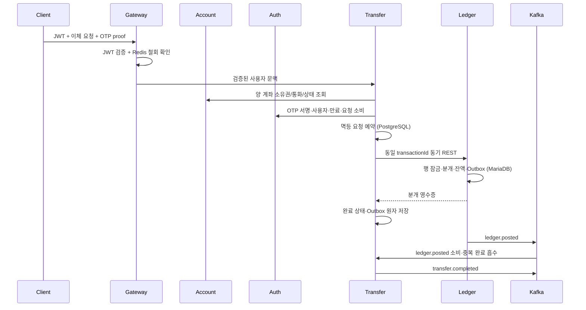

# MVP1 완료 기준과 로컬 검증 — 2026-10-19

범위는 인터넷뱅킹 MVP1과 이를 실행하는 Gateway·내부 인증이다. 기존 AWS Terraform과 다른 MVP의 비즈니스 기능은 이번 변경 대상이 아니다.

## 완료 체크리스트

- [x] Account의 기본 CGLIB 트랜잭션 프록시 기동 오류 수정. 임시 `compose.e2e-account-proxy-workaround.yaml` 없이 기동한다.
- [x] Gateway의 서명·만료·issuer/audience 검증에 Redis jti 철회 확인 추가. 로그아웃 토큰은 보호 API에서 401, 새 로그인 토큰은 정상 허용한다.
- [x] 잔액·내역의 소유권을 Account 내부 조회로 확인. 타인 조회는 403, 없는 계좌는 404다.
- [x] 이체 전 출금 계좌 소유권, 양 계좌 ACTIVE 상태와 통화 확인. 타인 출금은 403, 정지 계좌는 409다.
- [x] 유효한 사용자별 Mock TOTP로 발급한 서명 proof를 Auth에서 소비한 뒤에만 이체 예약/원장 호출을 수행한다.
- [x] OTP 위조·만료·타인 사용·다른 요청 재사용은 401. 반복 실패의 초안 잠금은 423이다.
- [x] 업무 예외 처리기의 우선순위를 명시해 잔액 부족 422, 중복 요청 409와 기존 이체 ID를 보존한다.
- [x] 본인의 신규 계좌는 원장 행이 없어도 Account의 통화로 잔액 0/200, 거래내역 빈 목록/200을 반환한다. 조회가 원장 행을 만들지 않는다.

## 상태·보안 계약

- 신규 계좌는 Account만 저장한다. Ledger는 실제 분개 시 계정을 lazy upsert한다. 잔액 조회에서 Account 존재/통화/소유권을 확인하므로 알려지지 않은 계좌를 0원으로 꾸미지 않는다.
- 출금과 입금 계좌 모두 ACTIVE일 때 이체한다. 상태 변경은 내부 인증이 필요한 작업이다.
- `GET /internal/v1/accounts/{accountId}`는 id/ownerId/currency/status만 제공한다. Ledger·Transfer는 각자의 `adapter/out/account` 클라이언트를 사용하며 다른 서비스 DB를 직접 읽지 않는다.
- `POST /internal/v1/auth/otp/consume`는 사용자, 서명, 만료와 proof 상태를 검증한다. 첫 소비에서 idempotency key와 정규화한 계좌/금액/통화 해시에 원자적으로 묶는다. 같은 요청 재시도는 허용하며 다른 요청은 거절한다. Transfer DB의 unique 제약이 실제 이체 중복을 최종 방어한다.
- proof 원문과 OTP 코드·비밀값은 DB/로그/이벤트에 저장하지 않는다. Auth V3 마이그레이션은 proof 사용 기록 테이블만 추가한다.
- 내부 API와 기존 계좌 상태 PATCH는 `X-Internal-Caller` + `X-Internal-Service-Token`을 요구한다. 토큰 미설정은 503, 틀린 내부 인증은 403으로 닫는다. 인코딩·context path를 포함해 정규화된 경로로 검사한다. Gateway는 외부 신원·내부 인증 헤더를 제거하고 내부 경로를 차단한다.
- 서비스 토큰은 Auth/Account/Ledger/Transfer에만, Mock OTP 서버 비밀은 Auth에만 주입한다. JWT 철회 키 접두사 `pg.auth.revocation-key-prefix`의 기본값은 양쪽 모두 `auth:revoked:jti:`다.



## 재검증

REST로 한 번에 실행하려면 [운영 API 사용법](OPERATIONS_API.md)을 참고한다.
`POST /ops/v1/performance-runs`로 접수한 뒤 `GET /ops/v1/performance-runs/{runId}`로
동일한 분리 Docker 검증의 단계/결과를 조회한다. 현재는 MVP1 기능 검증이며 부하 측정은 아니다.

```sh
# 기존 DB 비밀번호를 바꾸지 않고 누락된 내부/OTP 비밀값만 추가
python3 infra/docker/init-env.py /absolute/path/to/local.env --upgrade

# 다른 프로젝트·기존 데이터와 분리된 새 Docker 스택에서 자동 검증 후 정리
python3 infra/docker/run-mvp1-e2e.py --output /private/tmp/mvp1-result.json

# 전체 빌드·실제 DB 통합 테스트
./gradlew build -Pintegration=true
```

전체 Gradle 검증은 258개 테스트가 실패·오류·건너뜀 없이 통과했다. Docker 수용 검증 65개도 모두 통과했다. 정상 이체 외에도 권한, OTP, 만료, 중복, 오류 응답, 상태 변경, 로그아웃, 실제 Kafka 소비와 완료 중복 방지를 확인한다. 최종 증거는 `evidence/mvp1-completion-2026-10-19.json`에 저장한다.

## 적용·후속 범위

- 로컬 스택은 `docker,skeleton` 프로필을 사용한다. `*SkeletonConfiguration`이라는 이름은 기존 조립 계약을 유지한 것이며, MVP1 활성 경로는 실제 구현을 사용한다. 사용하지 않는 옛 placeholder 클래스는 활성 bean이 아니다.
- 이전 우회 기반 검증 보고서는 당시 조건을 기록한 이력이다. 현재 기준은 이 문서와 새 수용 검증 결과다.
- 초기 입금/자금 준비 API는 MVP1 범위 밖이므로 이체 테스트의 초기 잔액만 fixture로 준비한다. 이후 출금·입금·분개·완료·Outbox·Kafka는 실제 경로다.
- Mock OTP를 사용하며 실제 OTP 공급자·SMS 인증을 완료했다는 뜻은 아니다. JWT RSA 키를 공급하지 않으면 Auth 재시작 시 개발용 키가 바뀌므로 다시 로그인해야 한다.
- AWS의 production profile 활성화, 안정적인 RSA 키·서비스 비밀 주입, Redis IAM/MSK/TLS, 네트워크/가용성·목표 부하 검증은 별도 배포 작업이다. AWS 리소스 생성은 수행하지 않는다.
- Figma 기준: 직전에 조회한 시스템 구성도 `19:2`의 JWT·OTP·계좌·원장 흐름과 accepted ADR 0001. 이번 재조회는 MCP 호출 한도에 걸려 이후 도식 변경은 **확인 필요**다. 소유권/OTP 소비의 구체적인 내부 REST 경로는 이번 구현 계약이며 Figma에 반영했다고 주장하지 않는다.

## 로컬 적용 결과

검증한 최종 이미지로 Gateway/Auth/Account/Ledger/Transfer를 갱신했고 다섯 서비스가 healthy다. 기동 우회 환경값은 제거됐다. 기존 사용자·계좌·원장·이체 데이터의 집계가 갱신 전후 일치하며 DB 비밀번호와 볼륨은 유지했다. Auth V3 마이그레이션이 적용됐다. 실제 로컬 인스턴스에서도 일반/인코딩 내부 경로가 모두 403으로 차단된다.
